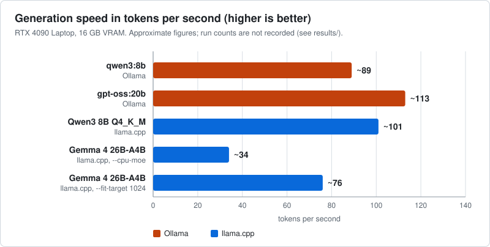

# local-llm-lab: local LLMs on Windows with PowerShell

A Windows and PowerShell lab for running open-weight language models locally on one gaming laptop (RTX 4090 Laptop, 16 GB VRAM, 64 GB RAM, Windows 11), measuring what each knob costs or buys, and wiring the result into real tools: an OpenAI-compatible API, a chat UI, and Claude Code itself.

<!-- summary:begin -->
<!-- generated by tools/render_results.py from results/*.json; do not edit by hand -->



**Main finding:** with Gemma 4 26B-A4B, a mixture-of-experts model that does not fit in 16 GB of VRAM, generation went from ~34 to ~76 tok/s when the experts were placed in VRAM first and only the remainder in system RAM, instead of all in RAM.
Why that works, and its limits: [MoE offload notes](docs/moe-offload.md).

<!-- summary:end -->

[](https://github.com/gonzalo-rosas-rojas/local-llm-lab/actions/workflows/checks.yml)

It is a learning lab, not a framework. The measurements are stored as data in [`results/`](results/), one JSON file per configuration with its provenance, and the tables and the chart in this README are generated from those files.

## What I measured

All numbers come from `llama-bench` (pp512 = prompt processing of 512 tokens, tg128 = generation of 128 tokens) or from Ollama's own timings, on this one machine, with no confidence intervals: treat them as ballpark figures, not a rigorous benchmark. Each one is a figure as I wrote it down at the time; what was not noted then is `null` in its record.

<!-- results:begin -->
<!-- generated by tools/render_results.py from results/*.json; do not edit by hand -->

### Stage 1: Ollama, models that fit in VRAM

| Model | Role | Speed | GPU / VRAM |
|---|---|---|---|
| `qwen3:8b` | fast starter | ~89 tok/s | 100% GPU, ~6 GB |
| `gpt-oss:20b` | main model (MoE, ~3.6B active) | ~113 tok/s | 100% GPU, ~14 GB |

### Stage 2: llama.cpp directly, same model as Ollama

Qwen3 8B Q4_K_M (4.68 GB), llama.cpp build b9482 with CUDA 12.4 binaries, NVIDIA driver 555.97.

| Metric | Value |
|---|---|
| Prompt processing (pp512) | ~5724 tok/s |
| Generation (tg128) | ~101 tok/s |
| VRAM, model + KV cache at q8_0, context 8192 | ~6.3 GB |

Same model through Ollama generates at ~89 tok/s, so llama.cpp is ~13% faster, in exchange for managing the flags yourself. See [docs/llama-cpp.md](docs/llama-cpp.md).

### Stage 3: Mixture-of-experts offload, a model that does not fit

Gemma 4 26B-A4B (25.23B parameters, ~3.8B active per token), GGUF UD-Q4_K_M, 15.78 GB: too big for 16 GB of VRAM once the KV cache and buffers are counted.

| Configuration | Experts | pp512 | tg128 | VRAM |
|---|---|---|---|---|
| `--cpu-moe` | all in RAM | ~459 tok/s | ~34 tok/s | ~5 GB |
| `--fit-target 1024` | as many in VRAM as fit | ~1628 tok/s | **~76 tok/s** | ~15 GB |

Do not offload more than you must: fill VRAM first and send only the remainder to RAM. Going from "everything in RAM" to auto-fit more than doubled generation speed (34 to 76 tok/s, 2.2x). See [docs/moe-offload.md](docs/moe-offload.md).

Each figure is one record in [`results/`](results/) with its provenance ([table](results/README.md#provenance-of-the-current-records)); what was not noted at the time is `null`.

<!-- results:end -->

## What I learned

- Prompt processing is compute-bound and generation is memory-bandwidth-bound (compare the pp512 and tg128 rows above), so a laptop GPU suffers most in generation.
- A quantized KV cache (`-ctk q8_0 -ctv q8_0`, needs flash attention) keeps an 8k context cheap.
- A 25B-parameter MoE runs like a small model because only ~3.8B parameters are active per token; the idle experts can wait in system RAM.
- Check CUDA/driver compatibility before downloading binaries: the CUDA 13.x llama.cpp build did not work with driver 555.97, the 12.4 build did.

## Claude Code on a local model

Ollama 0.14+ speaks the Anthropic Messages API, so Claude Code can run against a local model by setting a few environment variables for one launch. `scripts/claude-local.ps1` does that without touching the normal Claude Code setup. A local 8-30B model is much weaker than Claude in the agentic loop (tool calls fail, edits are imprecise), so it is for learning, light tasks and privacy, not a replacement. Details in [docs/claude-code-local.md](docs/claude-code-local.md).

## Run it

Windows 11, PowerShell 5.1+. If the execution policy blocks a script: `powershell -ExecutionPolicy Bypass -File .\scripts\<name>.ps1`.

```powershell
.\scripts\01-install-ollama.ps1     # install Ollama (idempotent), check the server
.\scripts\02-pull-models.ps1        # qwen3:8b and gpt-oss:20b
.\scripts\03-start-openwebui.ps1    # chat UI on http://localhost:3000 (needs Docker Desktop)

python -m venv .venv
.\.venv\Scripts\Activate.ps1
pip install -r clients\requirements.txt
python clients\smoke_test.py        # time to first token and speed over the OpenAI-compatible API
```

llama.cpp servers (download the binaries to `tools/llamacpp/` and the GGUF files to `models/gguf/`; neither is versioned):

```powershell
.\scripts\llama-server\run-qwen3-8b.ps1     # http://localhost:8080, UI and /v1 API
.\scripts\llama-server\run-gemma4-moe.ps1   # same, with MoE expert offload
```

Daily use: `.\scripts\start-lab.ps1` turns the lab on, `.\scripts\stop-lab.ps1` frees VRAM and RAM.

## Reproduce and extend the numbers

The figures above are archived records, not output of a script you can run to get them back: they were taken before this repository had a benchmark runner, and nothing in it regenerates them. What you can do:

- Regenerate the tables and the chart from `results/`: `python tools/render_results.py` (standard library only). `python tools/render_results.py --check` fails if the README or the SVG no longer match the data, and the tests run it.
- Produce new records on your own machine with `bench/run-bench.ps1`, which runs `llama-bench` several times, keeps every run and the median, and writes a JSON file in the same schema. See [docs/benchmarking.md](docs/benchmarking.md). It has not been run by the author yet, so no record in `results/` comes from it.
- Run the checks: `python -m unittest discover -s tests`.

## Security

Everything the lab starts listens on 127.0.0.1 only. `scripts/check-loopback.ps1` verifies it and [SECURITY.md](SECURITY.md) explains what is and is not exposed.

## Layout

```
scripts/            install, pull, start/stop, llama-server launchers, Claude Code launcher, loopback check
scripts/llama-server/   run-qwen3-8b.ps1, run-gemma4-moe.ps1 (the flags are explained in the header)
bench/              run-bench.ps1, a repeatable llama-bench runner that writes results/ records
clients/            smoke_test.py, a streaming client that reports TTFT and speed
results/            one JSON record per measurement, plus schema.json and its documentation
tools/              render_results.py, generates the README tables and the SVG chart
tests/              unit tests (records, generated files, client, benchmark conversion)
docs/               llama.cpp and MoE offload measurements, benchmarking, Claude Code on a local model
```

## License

MIT. Model weights are not included and keep their own licenses.
